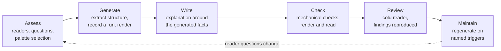

# Architecture Documentation from Evidence

> **Status:** PROVISIONAL. One project has applied this end to end (Agent Journal, October 2026). It is
> promoted into Forge doctrine only after a second project applies it and the result is reviewed.
> **Modes:** [existing code](#procedure) and [specification before the spike](SPEC-MODE.md).
> Keep three documents: the before spec, the after guide, and a change explanation when useful.
> The specification mode has one pre-spike review example; it has not completed an implementation cycle.
> **Format:** Markdown. Authored conceptual diagrams in Mermaid; diagrams generated from code or
> recordings as PlantUML source plus a committed SVG.

## What this is

A method for writing architecture documentation that a technically capable colleague can learn the
system from, where every structural or behavioural statement can be traced to something the reader can
check. It sits in Diataxis's *explanation* quadrant ([documentation taxonomy](../../concepts/documentation-taxonomy.md)):
it explains how a system is built and why, for maintainers, reviewers and downstream consumers. User-facing
tutorials, how-to guides and reference stay with [Phase 5](../../phases/05-documentation.md).

It is the design-time half of a pair. [Review lenses](../../concepts/review-lenses.md) is the review-time
half: each reader's concern gets a view that documents it and a lens that interrogates it.

## The two ideas that carry it

1. **Choose from a large palette per project; never fill a template.** Forty years of architecture
   documentation practice offer far more chapters, views and notations than any one system needs. The
   [palette](PALETTE.md) keeps all of them, with what each is for. An explicit [assess stage](ASSESS.md)
   selects what fits this project's readers and records what was declined and why. Agent Journal's guide
   has eight chapters because its assessment selected eight; another project will select differently.
2. **Every statement says what backs it.** A fixed set of [evidence labels](EVIDENCE.md) (declared design,
   declared policy, extracted structure, observed execution, executed check, static comparison, proposed)
   separates what the code is meant to do from what the build enforces, what the bytecode contains, what
   one run did and what is still only proposed. Tools generate the structural and behavioural facts; AI
   helps select reader questions and draft explanation around those facts, and never invents an edge, a
   call order or a number.

## Choose a mode

For existing code, follow the procedure below. Before code exists, use [specification mode](SPEC-MODE.md):
start with complete consumer programs or visible flows, then the public surface and operation contracts,
before mechanisms. It follows the [consumer-first guide](../../guides/consumer-first-design.md).
Choose reader questions and views, write a proposed spec with conceptual Mermaid diagrams, apply review
lenses and a fresh Codex review against a pinned outside KB, reproduce findings, then obtain owner
acceptance before the spike. Preserve the before spec and write the after guide separately.

## Procedure

*Conceptual diagram of the procedure.*

| Stage | Output | Exit |
|---|---|---|
| **Assess** | An assessment record ([template](templates/ASSESSMENT.md)): readers and their questions, the system's shape, what already exists, available evidence tools, every palette item selected or declined with a reason, public/private split, maintenance triggers | Each selected chapter or view answers a named reader question |
| **Generate** | Machine-readable extractions and textual diagram sources from pinned tools ([Java evidence pipeline](JAVA-EVIDENCE.md) for JVM projects) | Rebuilding from the same inputs gives the same facts; the build fails when committed generated files drift |
| **Write** | The guide ([skeleton](templates/ARCHITECTURE-GUIDE.md)) with a view description around each substantial visual ([template](templates/VIEW.md)) | Every statement carries an evidence label; links resolve |
| **Check** | Mechanical checks (references, membership, freshness, diagram syntax and lint) and a read of every rendered page at reading size | Checks green **and** a human has read the rendered output; layout checks do not establish correctness |
| **Review** | One cold reviewer who did not author it; each material finding reproduced before acting ([evidence standard](../../concepts/refutation-by-counterexample.md)) | Findings dispositioned; the reviewer can explain the core mechanism and locate its evidence |
| **Maintain** | Named regeneration triggers; dated evidence kept dated | A changed responsibility, boundary, contract or selected scenario triggers review of the affected views only |

## Files

| File | Read when |
|---|---|
| [PALETTE.md](PALETTE.md) | Choosing what to include: every method, chapter, view family, notation and evidence tool considered, with its sources |
| [ASSESS.md](ASSESS.md) | Starting documentation for a project: the questions, the selection heuristics, and the Agent Journal assessment worked through, including how its eight chapters were arrived at |
| [EVIDENCE.md](EVIDENCE.md) | Writing or reviewing any statement: the labels, what each kind of evidence can and cannot establish, and the rules learned the hard way |
| [JAVA-EVIDENCE.md](JAVA-EVIDENCE.md) | Generating evidence for a JVM project: component membership, generated views with drift checks, boundary rules with negative controls, scoped execution recording, diagram lint |
| [SPEC-MODE.md](SPEC-MODE.md) | Writing before code exists; independent outside-knowledge review; before/after/change documents |
| [tooling/README.md](tooling/README.md) | Adapting the local non-Java render/lint and recording tools, independently of the worked example |
| [templates/](templates/) | Assessment, view, guide, specification, change record and fresh review prompt |

## Provenance

Distilled from the Agent Journal architecture documentation work of 23–27 October 2026: a research
proposal on evidence-derived architecture documentation (23 October), the first build-checked guide
in the public repository ([first complete worked example at
`a64833b83486c07db76027f6f6c075fc7685b17b`](https://github.com/markpollack/agent-journal/tree/a64833b83486c07db76027f6f6c075fc7685b17b/docs/architecture)), a README and architecture-continuity investigation (25 October), and an
architecture-first rewrite of the long-form guide (26–27 October). Planning evidence for those steps
is held privately and cited here by date.

The generic non-Java tools now live [in this pack](tooling/README.md); the Journal revision is a
worked example, not their source at run time. A commit URL is precise but needs an upstream retained
reference to survive branch removal. Recheck the example links when upstream history changes.

## Promotion criteria

- A second project completes Assess → Maintain with this pack, and its assessment selects a different
  chapter set from Journal's for stated reasons.
- The templates survive that use without project-specific edits leaking back into them.
- A reusable skill is written only after that, and orchestrates the deterministic tools; it does not
  replace the assess stage's human decisions.
